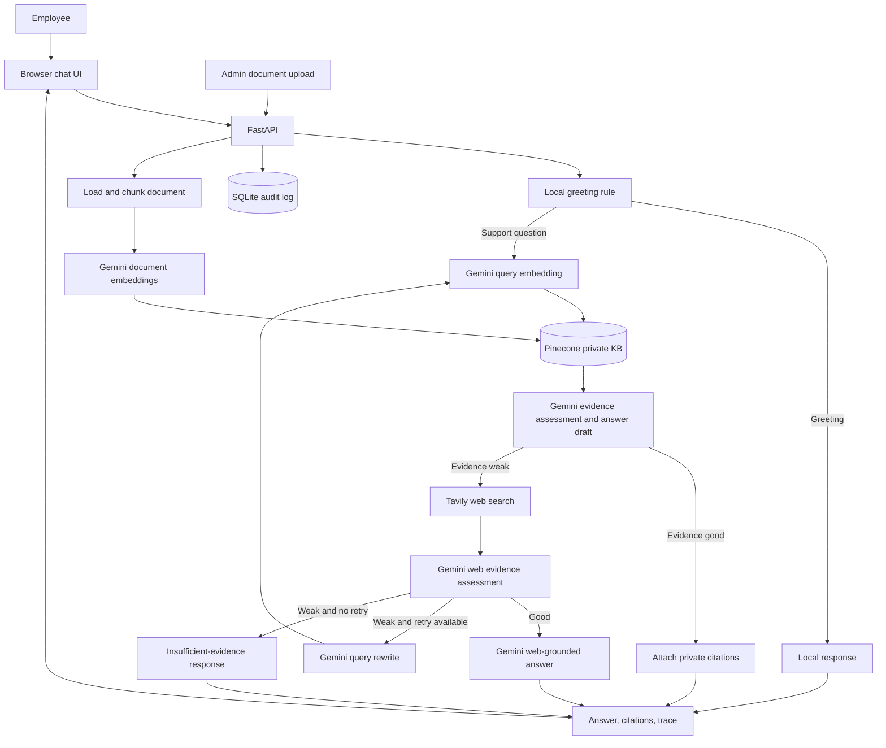

# 🚀 DeskPilot

> An IT support copilot that answers employee questions from trusted internal documents, with web search as a fallback when internal evidence is insufficient.

[](https://www.python.org/)
[]()

## 📌 Overview

**DeskPilot** is an agentic retrieval-augmented generation (RAG) application for enterprise IT support. It helps employees find clear answers in an internal knowledge base and reduces repetitive support questions. When private evidence is weak, it can search the public web and labels that information as external.

### ✨ Key Features

- **Private knowledge first:** Retrieves relevant internal document chunks from Pinecone.
- **Evidence-aware answers:** Assesses retrieved material and drafts a grounded answer in one Gemini call.
- **Web fallback:** Uses Tavily when internal evidence is insufficient, with a bounded rewrite and retry path.
- **Citations and trace:** Returns source information and a visible workflow trace with each response.
- **Document ingestion:** Accepts PDF, TXT, Markdown, and DOCX files through an admin-protected endpoint.
- **Latency-conscious routing:** Handles greetings locally and skips evidence grading when retrieval returns no results.
- **Audit trail:** Records the question, selected source, and workflow trace in SQLite.

## 🎯 Problem Statement

- **Problem:** Employees often create repeat tickets because useful IT guidance is difficult to locate.
- **Existing limitations:** Keyword search can return many documents, while an ungrounded chatbot can confidently invent policy details. The private knowledge base may also lack current vendor information.
- **Proposed solution:** Search private IT documents first, assess the evidence, and answer from it. Search the web only when private evidence is weak; abstain if neither source is reliable enough.
- **Target users:** Employees seeking IT help and IT staff maintaining internal support documentation.

## 🛠️ Tech Stack

| Component | Technology | Purpose |
|---|---|---|
| Frontend | HTML, CSS, JavaScript | Chat experience, citations, and workflow trace |
| Backend | Python, FastAPI | Chat and document ingestion APIs |
| Workflow | LangGraph | Routes retrieval, evidence assessment, fallback, and response steps |
| Chat and embeddings | Gemini through `langchain-google-genai` | Answer generation and text embeddings |
| Vector database | Pinecone | Stores and retrieves document embeddings |
| Web search | Tavily | Supplies external search results when private evidence is weak |
| Audit storage | SQLite | Stores basic request and decision-trace records |
| Document processing | LangChain loaders and text splitters, PyPDF, python-docx | Loads and chunks supported files |
| Container | Docker | Provides a container image for deployment |

## 🏗️ System Architecture



## ⚙️ How It Works

1. The employee submits a question in the browser.
2. A local rule handles simple greetings; other questions go directly to private knowledge retrieval.
3. The query is embedded and Pinecone returns the top matching document chunks.
4. Gemini assesses the private evidence and drafts an answer in the same request. Weak evidence proceeds to Tavily search.
5. Gemini assesses web evidence. The workflow answers from adequate evidence, rewrites and retries when configured, or abstains.
6. FastAPI returns the answer, citations, source, and trace; SQLite records a basic audit entry.

## 📂 Project Structure

```text
.
├── app/
│   ├── api/                 # FastAPI routes
│   ├── core/                # Settings and logging
│   ├── rag/                 # LangGraph workflow, state, and Pinecone access
│   ├── services/            # Ingestion and audit logging
│   └── main.py              # FastAPI application
├── data/
│   └── sample_kb/           # Demo IT handbook and service desk runbook
├── extra/                   # Problem statement, architecture assets, resume notes
├── static/                  # CSS and browser JavaScript
├── templates/               # Chat page template
├── .env.example             # Environment variable template
├── Dockerfile
├── requirements.txt
├── run.py
└── README.md
```

## 🚀 Getting Started

### Prerequisites

- Python 3.11+
- Gemini API key
- Pinecone API key
- Tavily API key for web fallback

### 1. Create and activate a virtual environment

Windows PowerShell:

```powershell
python -m venv .venv
.venv\Scripts\Activate.ps1
```

macOS/Linux:

```bash
python -m venv .venv
source .venv/bin/activate
```

### 2. Install dependencies

```bash
pip install -r requirements.txt
```

### 3. Configure environment variables

Copy `.env.example` to `.env` and set `GEMINI_API_KEY`, `PINECONE_API_KEY`, and `TAVILY_API_KEY`. The sample also provides the Gemini model, embedding model, Pinecone index, and namespace defaults. Never commit real keys or secrets.

The configured embedding model is `models/gemini-embedding-001` with 768 output dimensions. Embeddings from a different model cannot be mixed with this index: create a fresh compatible Pinecone index and re-ingest documents when changing embedding models. DeskPilot checks the index dimension and will not delete an incompatible index.

### 4. Run the application

```bash
python run.py
```

Open the local URL printed by the server. FastAPI's interactive API documentation is available at `/docs`.

## 💻 Usage

1. Start DeskPilot and open the chat page.
2. Ask a question such as:

   ```text
   What is the password reset policy?
   ```

3. Review the answer, source citations, and workflow trace.
4. To add internal knowledge, open **Add Company Document**, enter the configured admin API key, and upload a supported document.

The repository includes fictional demo documents under `data/sample_kb/`. Replace them with approved organization content before using DeskPilot with real users.

## 📸 Screenshots / Demo

No live demo or product screenshots are configured yet. The repository contains a previous architecture image in `extra/`; review it against the current Gemini-based implementation before presenting it as current documentation.

## 🧪 Testing

There is no automated test suite in the repository yet. Before relying on the assistant, add tests for routing, ingestion, evidence grading, citation handling, fallback, and abstention.

## 📊 Evaluation and Results

No benchmark results are currently recorded. Evaluate with a fixed set of realistic IT questions and report:

- **Dataset:** Number and categories of questions, including questions that should be answered and questions that should be refused.
- **Baseline:** Existing search or the previous workflow version.
- **Quality metrics:** Retrieval recall, answer correctness, citation support, and abstention quality.
- **Latency metrics:** End-to-end and per-stage p50/p95 time, separated into greeting, private-KB, and web-fallback requests.
- **Results:** Add measured values only after running the evaluation; do not infer performance from the design.
- **Limitations:** Record weak retrieval cases, stale source content, and any unsupported file or policy scenarios.

## 🔒 Security and Privacy

- Keep API keys in `.env` or a managed secret store; do not commit them.
- The document-ingestion route checks the `X-Admin-Key` header. Set a strong `ADMIN_API_KEY` before exposing the service.
- The current audit log stores question text and workflow traces in SQLite. Treat that database as sensitive and define access and retention controls before production use.
- The demo is not a complete enterprise identity or access-control system. Add authentication, authorization, upload limits, and operational monitoring before deployment to real employees.
- External web answers are labeled as outside information and should be validated before changing company-managed systems.

## 🗺️ Roadmap

- [x] Private knowledge retrieval with Pinecone
- [x] Gemini-grounded answer generation and evidence assessment
- [x] Tavily fallback and bounded query rewrite
- [x] Document upload and ingestion for supported formats
- [x] Source citations, workflow trace, and basic SQLite audit logging
- [ ] Automated tests and a repeatable RAG evaluation set
- [ ] Measure and publish latency and answer-quality results
- [ ] Add production authentication, upload limits, and audit retention controls
- [ ] Deploy and monitor a production instance

## 🤝 Contributing

Contributions are welcome. Open an issue to discuss a change, then submit a pull request with a clear description and relevant tests or evaluation evidence.

## 🛣️ Future Improvements

- Add hybrid keyword and vector retrieval and compare it against the evaluation set.
- Add document versioning, deletion, and re-indexing workflows.
- Add per-stage latency telemetry and user feedback on answer quality.
- Add authentication and role-based access for employees and knowledge administrators.
- Stream generated responses to improve perceived response time.

## ⚠️ Limitations

- Answer quality depends on the accuracy, coverage, and freshness of ingested documents.
- Retrieval and model judgments can still miss relevant evidence or assess evidence incorrectly.
- Web fallback requires Tavily credentials and adds external network latency.
- Existing embeddings must be regenerated when changing embedding models or dimensions.
- Latency and answer-quality improvements have not yet been measured with a repeatable benchmark.

## 📄 License

No license file is currently included. Add a license before distributing or accepting external contributions.

## 👤 Author

Add your name and profile links here before publishing the repository.

## 🙌 Acknowledgements

DeskPilot uses FastAPI, LangChain, LangGraph, Google Gemini, Pinecone, Tavily, and the Python document-processing libraries listed in `requirements.txt`.
